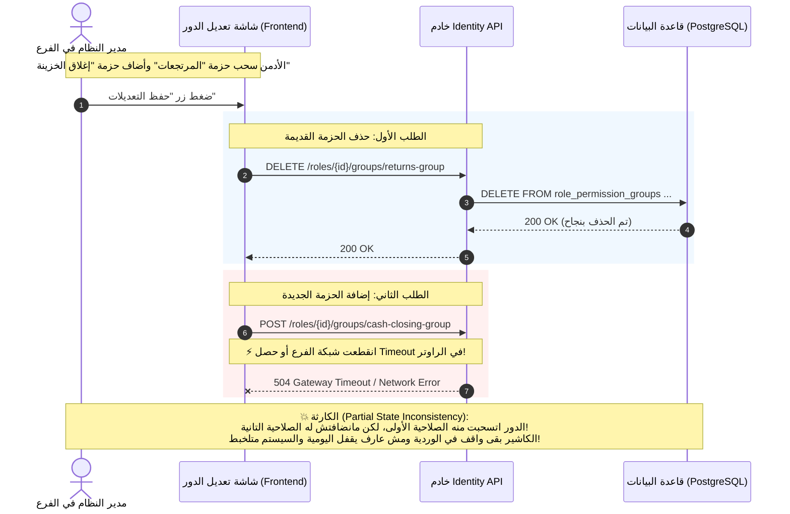

# ADR-004: التزامن الكامل للحالة (Full State Synchronization) مقابل الأوامر التفاضلية (Delta Commands) لإدارة باقات صلاحيات الأدوار

| Metadata | Details |
| :--- | :--- |
| **Status** | ✅ Accepted |
| **Date** | 2026-10-15 |
| **Author** | Senior Backend Engineer / Architecture Reviewer & Technical Partner |
| **Service** | SuperMarket.Identity |
| **Layer** | Application & Infrastructure (Roles Aggregate & Permission Group Links) |
| **Decision Scope** | Authorization Management, UI/UX State Convergence, Concurrency, Database I/O, Idempotency |

---

## 1. السياق والمشكلة بالضبط (Context & Exact Problem)

في نظام إدارة السوبرماركت بتاعنا، الأدوار الوظيفية (زي الكاشير، مشرف الوردية، مسؤول المستودع، مدير الفرع) مش مربوطة بصلاحيات ذرية مباشرة، بل مربوطة بـ "باقات صلاحيات" جاهزة (Permission Groups).

المشكلة ظهرت لما جينا نصمم الـ API اللي بيخدم شاشة تعديل الدور في لوحة التحكم (Admin Dashboard). في الواجهة (UI)، الأدمن بيفتح شاشة الدور ويشوف قدامه قائمة Checkboxes بكل باقات الصلاحيات المتاحة في النظام:
* حزم معلم عليها (ممنوحة للدور حالياً).
* حزم غير معلم عليها (غير ممنوحة).

الأدمن هنا ممكن يعمل كذا حركة في نفس اللحظة:
1. يشيل علامة الصح من حزمتين قدام (سحب صلاحيات).
2. يحط علامة الصح على 3 حزم جديدة (إعطاء صلاحيات).
3. يسيب 4 حزم زي ما هما بدون أي تغيير.

السؤال المعماري الحقيقي اللي وقفنا قدامه:
> **إزاي نصمم الـ API والـ Command اللي بينفذ العملية دي؟**  
> هل نخلي الـ Frontend يبعت الحالة الكاملة اللي الأدمن استقر عليها (Full State Sync) في ريكويست واحد؟  
> ولا نخليه يبعت كل حركة لوحدها عبر Endpoints منفصلة (`Assign` و `Revoke`)؟  
> ولا نطلب منه يحسب الفروقات بنفسه ويبعت لنا مصفوفة للي انضاف ومصفوفة للي انحذف؟

لو اخترنا أسلوب غلط هنا، هندفع تمنه غالي جداً: إما كود Frontend معقد ومليان أخطاء تزامن، أو استهلاك عالي جداً لقاعدة البيانات ومشاكل Deadlocks، أو فقدان ذرية العملية (Partial Failure) بحيث يتنفذ نص التعديل ويفشل النص التاني!

---

## 2. التحديات (Competing Challenges & Forces)

عندنا صراعات وقوى تقنية متعارضة لازم نوازن بينها:

1. **بساطة الـ Frontend وتجربة المطور (DX & Client Simplicity):**
   تطبيقات الـ Web (React / Vue) أو الموبايل أسهل وأأمن حاجة ليها إنها تحتفظ بـ State بسيطة عبارة عن مصفوفة الـ IDs اللي عليها علامة الصح حالياً: `selectedGroupIds = ["id1", "id2"]`. إجبار الـ Frontend إنه يقعد يقارن القديم بالجديد عشان يبعت لك مين انضاف ومين انحذف بيزود التعقيد جداً ويعرضنا لـ Bugs بشرية ملهاش أول من آخر.
2. **الذرية المطلقة (Atomicity & All-or-Nothing):**
   تعديل صلاحيات دور حساس في سوبرماركت مينفعش يتجزأ. مينفعش النظام يسحب صلاحية الإلغاء بس يفشل في إضافة صلاحية الاسترجاع ويسيب الدور في حالة معلقة في النص. العملية لازم كلها تنجح ككتلة واحدة أو تفشل كلها كأنها لم تكن.
3. **ترشيد استهلاك قاعدة البيانات (Minimal Database I/O):**
   في مهندسين بيستسهلوا وبيعملوا "امسح كل الروابط القديمة من الـ Database وضيف المبعوث كله من جديد" (Delete All then Insert All). ده في أنظمة الإنتاج الحقيقية كارثة أداء؛ لأنه بيكسر الـ Audit Logs، وبيولد استهلاك رهيب في الـ Write-Ahead Log (WAL) لـ PostgreSQL، وممكن يعمل Locks و Deadlocks في فترات الذروة.
4. **القابلية للتكرار والأمان عند فشل الشبكة (Idempotency & Self-Healing):**
   في فروع السوبرماركت النت وارد جداً يقطع أو يحصل Timeout والطلب يتبعت مرتين. لازم التصميم يضمن إن إعادة إرسال نفس الطلب ما تضربش استثناء تكرار قيود (`Unique Constraint Violation`) في قاعدة البيانات.

---

## 3. كيف ستحصل المشكلة بالضبط؟ (Workflow & Failure Scenarios)

لو ما فكرناش صح واعتمدنا مثلاً حل الأوامر التفاضلية المنفصلة (Granular Delta Endpoints: نقطة للإضافة ونقطة للحذف)، شوف سيناريو الكارثة اللي هيحصل على أرض الواقع:



### المشاكل اللي ظهرت في سيناريو الفشل:
1. **فقدان الـ Atomicity:** مفيش أي Database Transaction قادرة تلم كذا ريكويست HTTP جايين ورا بعض.
2. **فوضى التزامن (Race Conditions):** لو أدمن تاني شغال في نفس اللحظة وطلب ريكويستات تانية، الروابط هتتداخل وهيطلع الدور بحالة هجينة مشوهة.
3. **كابوس الـ Network Overhead:** لو عدلت 10 حزم صلاحيات، الـ Frontend هيبعت 10 ريكويستات HTTP منفصلة!

---

## 4. الحلول والبدائل مع المقايضات (Trade-offs Analysis)

درسنا 4 بدائل معمارية ووزنا مقايضات كل حل بكل دقة:

| البديل | إيه اللي بنكسبه؟ (Pros) | إيه اللي بنخسره؟ (Cons & Trade-offs) | القرار والتقييم |
| :--- | :--- | :--- | :--- |
| **1. الأوامر الدقيقة المنفصلة (Granular Endpoints: Assign & Revoke)** | مسارات RESTful تقليدية وحجم الـ Payload صغير جداً. | فقدان الذرية (Partial Failures)، كابوس في الـ Network، واحتمال كبير تترك الدور في حالة مشوهة. | **مرفوض ❌** لخطورته على أمان وصحة النظام. |
| **2. إرسال الفروقات من العميل (Batch Delta: Add/Remove Arrays)** | الـ Payload بيحتوي بس على اللي اتغير، وممكن يتنفذ في ترانزاكشن واحدة. | بينقل تعقيد حساب الفروقات (Diffing) للـ Frontend، ولو الـ Frontend حصل فيه Bug في الـ State هيبعت داتا بايظة تعمي قاعدة البيانات. | **مرفوض ❌** لأن منطق الأعمال وتدقيق البيانات مكانه السيرفر مش المتصفح. |
| **3. المسح الشامل وإعادة الإدخال (Delete All & Insert All)** | كود السيرفر في غاية البساطة والكسل (Delete where RoleId ثم Insert All). | بيدمر أداء قاعدة البيانات، بيولد I/O عالي جداً في الـ WAL Logs، وبيغير الـ Primary Keys وتواريخ التدقيق (Auditing) لروابط مكنتش محتاجة تتلمس أصلاً، وممكن يعمل Deadlocks. | **مرفوض قطعاً ❌** ده أسلوب لا يليق بنظام Enterprise. |
| **4. التزامن الكامل للحالة مع Diffing بالـ Backend (Full State Sync with In-Memory Diffing)** | بساطة مطلقة للـ Frontend، ترانزاكشن ذرية واحدة، حماية تامة لـ Audit Logs، واستهلاك صفري لـ SQL لو مفيش تغيير فعلي (Natural Idempotency). | بيتطلب جلب الروابط الحالية للدور في الذاكرة لحساب الفروقات قبل التعديل. | **معتمد ومختار ✅ (أفضل حل معماري متوازن).** |

---

## 5. الحل الذي اخترناه وطريقة العمل بالتفصيل (The Chosen Architecture & Mechanics)

اعتمدنا **التزامن الكامل للحالة (Full State Synchronization) مع خوارزمية الـ In-Memory State Diffing في الـ Backend**.

### 1. شكل العقد البرمجي (Command Contract):
الـ Frontend يبعت فقط مصفوفة المعرفات اللي الأدمن استقر عليها كحالة نهائية للدور:
```csharp
public sealed record UpdateRolePermissionGroupsCommand(
    Guid RoleId, 
    IReadOnlyList<Guid> PermissionGroupIds) : ICommand;
```

### 2. آلية العمل داخل الـ Handler بالتفصيل:
كود الـ Handler في [UpdateRolePermissionGroupsCommandHandler.cs](file:///d:/dotnet/POS/src/Services/Identity/SuperMarket.Identity.Application/Roles/Commands/UpdateRolePermissionGroups/UpdateRolePermissionGroupsCommandHandler.cs) بيشتغل بالخطوات التالية:

1. **التحقق من وجود الدور نفسه:**
   لو الدور مش موجود، نرجع `RoleErrors.NotFound` فوراً بدون إكمال.
2. **التحقق الدفاعي المسبق (ADR-003 Pre-flight Validation):**
   لو القائمة فيها معرّفات، نتأكد بـ Query واحد سريع إن كل باقات الصلاحيات موجودة فعلاً في جدول `permission_groups`. لو فيه معرّف واحد وهمي أو محذوف، الطلب يترفض فوراً قبل ما نلمس جدول الروابط.
3. **جلب الروابط الحالية للدور من قاعدة البيانات:**
   ```csharp
   var existingLinks = await _roleRepository.GetRolePermissionGroupsAsync(command.RoleId, cancellationToken);
   var existingGroupIds = existingLinks.Select(l => l.GroupId).ToHashSet();
   var targetGroupIds = command.PermissionGroupIds.ToHashSet();
   ```
4. **حساب الفروقات في الذاكرة (In-Memory Diffing):**
   * **اللي محتاج يتحذف (`linksToRemove`):** الروابط اللي موجودة في الداتابيز ومش موجودة في طلب الأدمن الجديد:
     ```csharp
     var linksToRemove = existingLinks.Where(l => !targetGroupIds.Contains(l.GroupId)).ToList();
     ```
   * **اللي محتاج ينضاف (`groupIdsToAdd`):** الحزم اللي الأدمن طلبها ومش موجودة أصلاً في الداتابيز:
     ```csharp
     var groupIdsToAdd = targetGroupIds.Where(id => !existingGroupIds.Contains(id)).ToList();
     ```
   * **المشترك:** لا يلمسه الـ ORM ولا تتبعت له أي جملة SQL!
5. **التنفيذ الذري عبر الـ Unit of Work:**
   * نمرر المحذوف للـ Change Tracker: `_roleRepository.RemoveRolePermissionGroups(linksToRemove)`.
   * ننشئ الكيانات الجديدة بعد تطبيق قواعد الدومين ونمررها: `_roleRepository.AddRolePermissionGroups(linksToAdd)`.
   * لو حصل أي تغيير فعلي، نستدعي: `await _unitOfWork.SaveChangesAsync(cancellationToken)`.

---

## 6. كيف سوف يكون الحل بعد اختيارنا له بالضبط؟ (Workflow & Success Scenarios)

شوف جمال وسلاسة النظام بعد تطبيق الحل؛ كل شيء يتم في ترانزاكشن ذرية محمية ومستقرة:

```mermaid
sequenceDiagram
    autonumber
    actor Admin as مدير النظام
    participant UI as شاشة الدور (Frontend)
    participant API as خادم Identity API
    participant Handler as UpdateRolePermissionGroupsHandler
    participant DB as PostgreSQL Database

    Admin->>UI: اختار حزمتين وشال واحدة وضغط "حفظ"
    UI->>API: PUT /api/v1/roles/{id}/permission-groups <br/> Payload: [Group_2, Group_3]
    
    API->>Handler: Dispatch Command
    Handler->>DB: 1. SELECT Role (التأكد من وجود الدور)
    Handler->>DB: 2. SELECT COUNT(*) FROM permission_groups WHERE id IN (G2, G3)
    Note over Handler: الفحص الاستباقي نجح: الحزم كلها حقيقية وموجودة
    
    Handler->>DB: 3. SELECT Existing Links FOR RoleId
    DB-->>Handler: Existing Links: [Group_1, Group_2]
    
    rect rgb(235, 255, 235)
    Note over Handler: In-Memory State Diffing:<br/>- To Remove: [Group_1]<br/>- To Add: [Group_3]<br/>- Unchanged: [Group_2] (يُترك كما هو)
    end
    
    Handler->>DB: 4. BEGIN TRANSACTION<br/>DELETE FROM role_permission_groups WHERE role_id=@id AND group_id=G1;<br/>INSERT INTO role_permission_groups (role_id, group_id) VALUES (@id, G3);<br/>COMMIT TRANSACTION;
    DB-->>Handler: Success (1 Row Deleted, 1 Row Inserted)
    
    Handler-->>API: Result.Success()
    API-->>UI: 200 OK (تم الحفظ بنجاح تام وبشكل ذري)
    UI-->>Admin: إشعار أخضر: "تم تحديث باقات الصلاحيات بنجاح"
```

### سيناريو إعادة المحاولة التلقائي (Retry / Self-Healing Scenario):
لو انقطعت الشبكة والـ Frontend قرر يعيد إرسال نفس الطلب بعد ثانيتين:
1. الـ Handler هيجيب الروابط الحالية من الداتابيز فيلاقيها `[Group_2, Group_3]`.
2. هيقارنها بالمطلوب `[Group_2, Group_3]`.
3. هيلاقي `linksToRemove` = صفراً، و `groupIdsToAdd` = صفراً.
4. الـ Handler **مش هيستدعي `SaveChangesAsync` أصلاً** ومش هيبعت ولا استعلام تعديل للداتابيز.
5. هيرجع `Result.Success()` فوري بـ 200 OK دون استهلاك أي موارد (Natural Idempotency).

---

## 7. زاوية المقابلة التقنية (Senior Interview Defense)

لو سألك المحاور في إنترفيو Senior / Staff Backend Engineer:
> **"ليه في شاشات الـ Many-to-Many زي ربط الصلاحيات بالأدوار عملت Full Sync وما عملتش Granular Endpoints زي Assign/Revoke؟"**

**الإجابة النموذجية المهندمة:**
> "في تصميم الـ APIs، لازم نوازن بين نقاء الـ REST وبين استقرار النظام وتجربة المطور (DX).
> لو اعتمدنا الـ Granular Commands (`Assign` و `Revoke`)، هننقل عبء إدارة الحالة المتزامنة للـ Frontend، وهنخلق مشكلة أمنية وتشغيلية خطيرة وهي الـ **Partial Failure**؛ لأن الـ HTTP بطبيعته Stateless ومفيش ترانزاكشن تقدر تضمن ذرية 5 طلبات شبكة جايين ورا بعض.
> 
> وعشان كده، اعتمدنا الـ **Full State Synchronization**: العميل بيبعت الحالة المنطقية النهائية اللي استقر عليها في طلب واحد.
> ومنعاً لخطأ المبتدئين الشائع وهو (Delete All then Insert All) اللي بيدمر الـ Database WAL Logs والـ Audit Trail، نفذنا في الـ Backend خوارزمية **In-Memory State Diffing**: بنجيب الروابط القديمة ونقارنها بالجديدة؛ ما زال مطلوباً يظل كما هو، وما حُذف فقط يُحذف، وما استُحدث فقط يُضاف.
> بكده حققنا: ذرية كاملة (100% Atomicity)، وترشيد أقصى لعمليات الـ SQL I/O، وخصيصة الـ **Natural Idempotency** اللي بتخلي النظام يتعافى ذاتياً عند إعادة إرسال الطلبات بدون أي كلفة إضافية."
