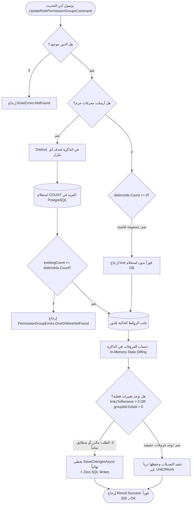

# ADR-005: الـ Idempotency والتعقيم الدفاعي للمدخلات في فحص وربط حزم الصلاحيات

| Metadata | Details |
| :--- | :--- |
| **Status** | ✅ Accepted |
| **Date** | 2026-10-15 |
| **Author** | Senior Backend Engineer / Architecture Reviewer & Technical Partner |
| **Service** | SuperMarket.Identity |
| **Layer** | Application & Infrastructure (Persistence Repository & Command Handler) |
| **Related Code** | `PermissionGroupRepository.AllExistAsync`, `UpdateRolePermissionGroupsCommandHandler` |
| **Decision Scope** | Input Sanitization, Vacuous Truth Semantics, False-Negative Bug Prevention, Natural Idempotency |

---

## 1. السياق والمشكلة بالضبط (Context & Exact Problem)

أثناء بناء التحقق المسبق (Pre-flight Validation) لأمر تحديث باقات صلاحيات الأدوار، كتبنا دالة في الـ Repository اسمها `AllExistAsync` مهمتها التأكد إن كل الـ `PermissionGroupIds` اللي باعتها العميل موجودة فعلياً في جدول `permission_groups` قبل ما نلمس جدول الروابط.

في قلب الدالة دي، فيه سطرين يبانوا في الظاهر عاديين جداً، لكن وراهم قرارات معمارية عميقة:

```csharp
public async Task<bool> AllExistAsync(IEnumerable<Guid> groupIds, CancellationToken cancellationToken = default)
{
    ArgumentNullException.ThrowIfNull(groupIds);

    // السطر الأول: التعقيم وإزالة التكرار
    var distinctIds = groupIds.Distinct().ToList();
    
    // السطر الثاني: معالجة حالة المجموعة الفارغة
    if (distinctIds.Count == 0)
    {
        return true;
    }

    var existingCount = await DbContext.PermissionGroups
        .CountAsync(g => distinctIds.Contains(g.Id), cancellationToken);

    return existingCount == distinctIds.Count;
}
```

المشكلة الحقيقية هنا ثلاثية الأبعاد:
1. **فخ الرفض الكاذب (False-Negative Bug):** لو العميل بعت معرّفات مكررة في الـ Payload (سواء بسبب خطأ في كود الـ Frontend أو ضعف فحص في الشبكة)، المقارنة التقليدية بالعدد هتضرب رفض كاذب، وهترفض طلب سليم وتدعي إن الحزم مش موجودة بينما هي موجودة فعلاً في الداتابيز!
2. **استعلامات الـ SQL العبثية وإمكانية سحب الصلاحيات:** لو الأدمن قرر يسحب كل الصلاحيات من دور معين، هيبعت مصفوفة فاضية `[]`. لو اتعاملنا مع الفاضي بسذاجة، يا إما هنبعت استعلام SQL ملوش أي معنى للداتابيز، يا إما هنرجع `false` ونمنع الأدمن من سحب الصلاحيات!
3. **الـ Natural Idempotency عند تكرار الريكويست:** لو نفس الطلب اتبعت 5 مرات ورا بعض بسبب مشاكل الشبكة، إزاي نضمن إن النظام ما يضربش أخطاء وما يستهلكش موارد الداتابيز عالفاضي؟

---

## 2. التحديات (Competing Challenges & Forces)

1. **التعامل مع المدخلات المشوهة دون كسر الـ Business:**
   الأدمن في شاشة الإدارة اختار حزمتين، لكن كود المتصفح لسبب ما بعت `[ID_A, ID_A, ID_B]`. هل نرفض الطلب ونطلع له إيرور غير مفهوم، ولا نعقم المدخلات في الذاكرة ونفهم نيته الحقيقية ونسهل تجربة المستخدم (Robustness Principle: "Be conservative in what you send, be liberal in what you accept")؟
2. **احترام المنطق الرياضي الصارم (Vacuous Truth):**
   بديهة بعض المطورين المبتدئين بتقول: "قائمة فاضية؟ يعني مفيش حاجة موجودة، رجّع false!". لكن منطقياً ورياضياً، السؤال هو: *"هل كل عنصر في القائمة المعطاة موجود في النظام؟"* في القائمة الفارغة، مفيش ولا عنصر واحد غير موجود، فالإجابة المنطقية الحتمية هي **`true`**. لو رجعنا `false` كسرنا منطق الـ Revocation بالكامل.
3. **حماية أداء السيرفر وقاعدة البيانات (Zero Waste Database I/O):**
   مينفعش نطلق استعلام شبكة لقاعدة البيانات واحنا عارفين النتيجة مسبقاً في الـ RAM، ومينفعش نفتح ترانزاكشن ونعدل صفوف لو كانت الحالة الحالية في الداتابيز مطابقة أصلاً للحالة المطلوبة.

---

## 3. كيف ستحصل المشكلة بالضبط؟ (Workflow & Failure Scenarios)

لو كتبنا كود الفحص بالطريقة الساذجة الشائعة، شوف الكارثة الصامتة والـ Bug اللي هيحصل في بيئة الإنتاج:

```mermaid
sequenceDiagram
    autonumber
    actor Admin as مدير الفرع
    participant UI as لوحة التحكم
    participant API as خادم Identity API
    participant Repo as PermissionGroupRepository (Naive Code)
    participant DB as PostgreSQL Database

    Note over Admin,UI: الأدمن اختار حزمتين: حزمة الكاشير وحزمة المرتجعات
    Note over UI: خطأ برمجي غير مقصود في المتصفح ضاعف المعرف الأول:<br/>groupIds = [ID_A, ID_A, ID_B] (الحجم = 3)
    UI->>API: PUT /roles/{id}/groups <br/> Payload: [ID_A, ID_A, ID_B]
    
    API->>Repo: AllExistAsync([ID_A, ID_A, ID_B])
    
    Note over Repo: الكود الساذج يرسل المعرفات كما هي بدون Distinct:
    Repo->>DB: SELECT COUNT(*) FROM permission_groups WHERE id IN (ID_A, ID_A, ID_B)
    
    Note over DB: محرك PostgreSQL يفحص وجود الصفوف في الجدول:<br/>يوجد صف واحد لـ ID_A وصف واحد لـ ID_B.<br/>النتيجة: COUNT = 2!
    DB-->>Repo: Returns 2
    
    rect rgb(255, 235, 235)
    Note over Repo: فخ المقارنة الساذج:<br/>return count == groupIds.Count;<br/>return 2 == 3;  ==>  FALSE! 💥
    end
    
    Repo-->>API: returns false
    API-->>UI: 404 Not Found (PermissionGroupErrors.OneOrMoreNotFound)
    UI-->>Admin: خطأ أحمر: "توجد حزم صلاحيات غير موجودة في النظام!"
    
    Note over Admin: 🤯 الأدمن يفتح الداتابيز يلاقي الحزمتين موجودين قدامه وسليمين!<br/>فريق الدعم الفني يضيع ساعات يدور ورا شبح Bug وهمي!
```

### المشاكل الصريحة في هذا السيناريو:
1. **False-Negative Error:** العميل تاه بسبب رسالة خطأ كاذبة تماماً.
2. **استعلام SQL غير صالح عند القائمة الفارغة:** لو أرسل العميل `[]` بدون شرط `distinctIds.Count == 0`، هيتولد استعلام غريب زي `WHERE id IN ()` يترجمه الـ ORM لـ `WHERE 1 = 0` ويهدر Roundtrip كامل عالفاضي.

---

## 4. الحلول والبدائل مع المقايضات (Trade-offs Analysis)

| البديل | إيه اللي بنكسبه؟ (Pros) | إيه اللي بنخسره؟ (Cons & Trade-offs) | القرار والتقييم |
| :--- | :--- | :--- | :--- |
| **1. الكود الساذج بدون تعقيم (Naive Count Comparison)** | سطرين كود ومفيش أي مجهود ذهني. | بيضرب Bug الرفض الكاذب فوراً مع أي تكرار، وبيفشل في معالجة القوائم الفارغة. | **مرفوض بشدة ❌** |
| **2. الرفض الصارم من الـ Validator (Strict FluentValidation Rule)** | بنجبر العميل يبعت داتا نظيفة 100% ومفيهاش أي تكرار. | بيخلي الـ API هش وغير مريح (Brittle DX)، وأي خطأ بسيط في كود الواجهة يوقف شغل الموظفين في الفرع بدون داعٍ. | **مرفوض ❌** (المرونة والتعقيم الداخلي أفضل). |
| **3. استخدام `DISTINCT` داخل استعلام الـ SQL نفسه** | بنخلي الداتابيز هي اللي تعقم الداتا. | بنحمل محرك الداتابيز عبء حسابي إضافي وشبكة رايحة جاية في مدخلات نقدر ننضفها في الذاكرة بـ Microseconds. | **مرفوض ❌** (حسابات الميموري أرخص بملايين المرات من الـ DB I/O). |
| **4. تعقيم الميموري بـ `Distinct()` وتطبيق الحقيقة الفارغة (المعتمد)** | مناعة تامة ضد الـ False Negatives، أداء فائق في الـ RAM، حماية الداتابيز من الاستعلامات العبثية، ومرونة ممتازة. | تستهلك جزءاً متناهي الصغر من الذاكرة لتخصيص القائمة المعقمة (مهمل تماماً لأن عدد الحزم للدور نادراً ما يتعدى بضع عشرات). | **معتمد ومختار ✅** |

---

## 5. الحل الذي اخترناه وطريقة العمل بالتفصيل (The Chosen Architecture & Mechanics)

الحل بيعتمد على ركيزتين أساسيتين: **التعقيم في الذاكرة** و **الـ Natural Idempotency في الـ Handler**.

### 1. تفكيك كود `AllExistAsync`:

```csharp
public async Task<bool> AllExistAsync(IEnumerable<Guid> groupIds, CancellationToken cancellationToken = default)
{
    ArgumentNullException.ThrowIfNull(groupIds);

    // 1. تصفية التكرار في الذاكرة أولاً
    var distinctIds = groupIds.Distinct().ToList();
    
    // 2. معالجة حالة القائمة الفارغة (Vacuous Truth)
    if (distinctIds.Count == 0)
    {
        return true; // نرجع true فوراً بدون لمس الداتابيز
    }

    // 3. الاستعلام باستخدام المعرفات الفريدة حصراً
    var existingCount = await DbContext.PermissionGroups
        .CountAsync(g => distinctIds.Contains(g.Id), cancellationToken);

    // 4. المقارنة العادلة والرياضية الدقيقة
    return existingCount == distinctIds.Count;
}
```

* **ليه `distinctIds.Count == 0` بترجع `true`؟**
  لأنها تعني إن العميل باعت قائمة فاضية (بيسحب كل الصلاحيات). مفيش أي حزمة في القائمة دي "غير موجودة". فالحقيقة المنطقية متحققة بنجاح، وكمان وفرنا رحلة استعلام (Roundtrip) كاملة على الداتابيز.
* **ليه بنقارن `existingCount == distinctIds.Count`؟**
  لأن كلا الطرفين دلوقتي بيمثل **"عدد الكيانات الفريدة الحقيقية"**؛ وبالتالي لو الداتابيز لقت 2 والـ distinctIds عددهم 2، فالنتيجة `true` حتى لو كان العميل باعت الـ ID متكرر 5 مرات في الريكويست الأصلي.

### 2. تحقيق الـ Natural Idempotency في الـ Handler:
في كود [UpdateRolePermissionGroupsCommandHandler.cs](file:///d:/dotnet/POS/src/Services/Identity/SuperMarket.Identity.Application/Roles/Commands/UpdateRolePermissionGroups/UpdateRolePermissionGroupsCommandHandler.cs#L43-L90):

```csharp
var existingLinks = await _roleRepository.GetRolePermissionGroupsAsync(command.RoleId, cancellationToken);
var existingGroupIds = existingLinks.Select(l => l.GroupId).ToHashSet();
var targetGroupIds = command.PermissionGroupIds.ToHashSet();

var linksToRemove = existingLinks.Where(l => !targetGroupIds.Contains(l.GroupId)).ToList();
var groupIdsToAdd = targetGroupIds.Where(id => !existingGroupIds.Contains(id)).ToList();

// لو مفيش أي إضافة أو حذف، لا نستدعي الداتابيز إطلاقاً!
if (linksToRemove.Count > 0 || groupIdsToAdd.Count > 0)
{
    await _unitOfWork.SaveChangesAsync(cancellationToken);
}

return Result.Success();
```

---

## 6. كيف سوف يكون الحل بعد اختيارنا له بالضبط؟ (Workflow & Success Scenarios)

شوف كيف يتعامل النظام بكل سلاسة وأمان مع السيناريوهات الصعبة وحالات إعادة الطلبات:



### سيناريو تكرار الطلب 3 مرات (Retries under Poor Network):
1. **المرة الأولى:** النظام يكتشف إن فيه حزمة جديدة انضافت، يكتبها في الداتابيز، ويرجع نجاح. الرد تأخر في الوصول للمتصفح بسبب رداءة اتصال الفرع.
2. **المرة الثانية (Retry تلقائي من المتصفح):** الـ Handler يفحص الحالة، يلاقي الروابط في الداتابيز مطابقة للمطلوب تماماً. `linksToRemove` = 0 و `groupIdsToAdd` = 0. يتخطى الـ DB فوراً ويرجع `200 OK`.
3. **النتيجة:** مفيش أي استثناء تكرار قيود (`Unique Constraint Violation`) ومفيش أي استهلاك لموارد الـ Write في السيرفر!

---

## 7. زاوية المقابلة التقنية (Senior Interview Defense)

لو اتسألت في إنترفيو Senior Backend Engineer:
> **"في دالة التحقق من وجود المعرفات في الداتابيز، ليه عملت `.Distinct().ToList()` في الـ C# وليه عملت `if (count == 0) return true`؟ وليه ما سبتش الداتابيز هي اللي تتصرف؟"**

**الإجابة النموذجية المهندمة:**
> "الهدف هنا هو الجمع بين **الدفاعية في التحقق (Defensive Validation)** و**حماية موارد النظام من الـ False-Negative Failures والـ I/O العبثي**.
> 
> أولاً، لو اعتمدنا على المقارنة المباشرة `count == groupIds.Count` بدون تعقيم بالـ `Distinct()`، فأي طلب يحتوي على معرّفات مكررة عن طريق الخطأ هيتسبب في رفض الطلب بشكل كاذب؛ لأن الـ SQL `COUNT(*)` بيعد الصفوف الفريدة المطابقة في الجدول، فلو الجدول فيه صفين والمدخل فيه 3 عناصر مكررة، المقارنة الساذجة هتقول `2 == 3` يعني `false` والطلب يترفض رغم إن كل البيانات موجودة فعلاً! تنظيف القائمة في الـ RAM هو $O(N)$ In-Memory بتكلفة تقترب من الصفر مقارنة بتكلفة خطأ تشغيلي في الإنتاج.
> 
> ثانياً، شرط `if (distinctIds.Count == 0) return true` بيحقق مبدأ المنطق الرياضي الصارم المعروف بـ **Vacuous Truth (الحقيقة الفارغة)**: السؤال اللي الدالة بتجاوب عليه هو: *هل يوجد أي عنصر في القائمة مفقود من قاعدة البيانات؟* بالنسبة للمجموعة الخالية، لا يوجد أي عنصر مفقود، فالشرط محقق حتماً. وبجانب الصحة الرياضية، ده وفر علينا رحلة استعلام شبكة عبثية لقاعدة البيانات بصيغة `WHERE id IN ()`، ومكّن نظامنا من دعم سحب الصلاحيات الكامل (Full Revocation) بأمان تام."
