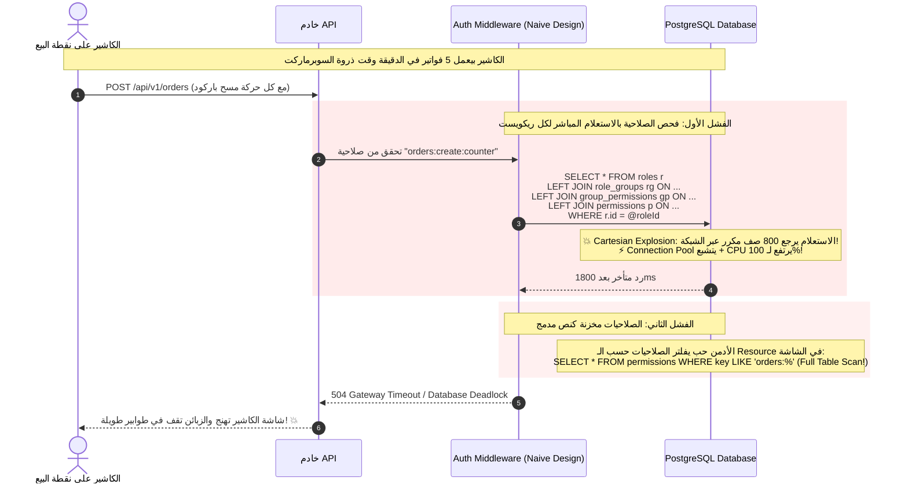
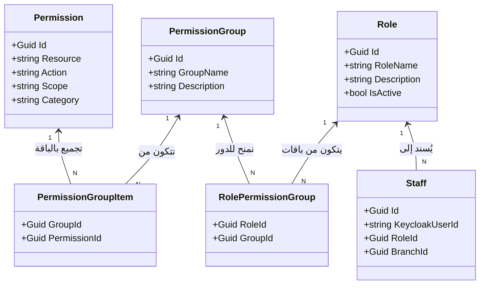
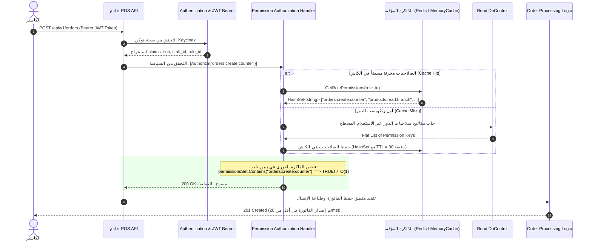

# ADR-006: معمارية الصلاحيات والأدوار الديناميكية: التخزين العلائقي، الاسترجاع عالي الأداء، والتحقق وقت التشغيل

| Metadata | Details |
| :--- | :--- |
| **Status** | ✅ Accepted |
| **Date** | 2026-10-15 |
| **Author** | Senior Backend Engineer / Architecture Reviewer & Technical Partner |
| **Service** | SuperMarket.Identity |
| **Layer** | Cross-Cutting: Domain, Infrastructure (PostgreSQL / EF Core), Application, and Authorization Pipeline |
| **Related Entities** | `Permission`, `PermissionGroup`, `PermissionGroupItem`, `Role`, `RolePermissionGroup`, `Staff` |
| **Decision Scope** | Relational Normalization (1NF), Dynamic Hybrid RBAC/PBAC, Canonical Key Synthesis, Query Optimization, Runtime Enforcement |

---

## 1. السياق والمشكلة بالضبط (Context & Exact Problem)

في أنظمة التجزئة وإدارة فروع السوبرماركت (POS Systems)، الهياكل الوظيفية مستحيل تكون ثابتة أو متطابقة:
* فرع سوبرماركت صغير في حي هادي محتاج يدمج دور "أمين الصندوق" (Cashier) مع "مسؤول استلام المرتجعات".
* فرع هايبرماركت ضخم محتاج يفصل بدقة بين "كاشير عادي"، و"مشرف وردية"، و"مدير فرع"، و"مراجع مالي"، و"أمين مستودع مركزي".
* في أوقات المواسم والمبيعات (زي رمضان أو البلاك فرايداي)، الإدارة بتحتاج تنشئ أدوار مؤقتة زي "مساعد تغليف موسمي" بصلاحيات قراءة فقط لطباعة الملصقات.

لو اعتمدنا الحل التقليدي السطحي اللي هو عمل `enum SystemRoles { Cashier, Manager, Admin }` وربط الصلاحيات بثوابت صلبة داخل كود البرنامج (Hardcoded):
1. **أي دور جديد هيتطلب تعديل كود وتجهيز Deployment وإعادة تشغيل الخدمات (Downtime).**
2. **انفجار مصفوفة الصلاحيات:** لو النظام فيه 120 صلاحية ذرية، ربط الموظف أو الدور بـ 120 Checkbox في الشاشة بيمثل كابوس تشغيلي وثغرة أمنية فادحة.
3. **السؤال المعماري الحرج:** هل نخزن الصلاحية في الداتابيز كنص واحد مدمج زي `"products:create:branch"`؟ ولا نفصلها لأعمدة علائقية (`Resource`, `Action`, `Scope`)؟ وهل هنحتاج ملف يدمجهم؟ وإزاي السيرفر هيقرأ ويفحص الكلام ده في كل ريكويست بدون ما يوقع الداتابيز؟

---

## 2. التحديات (Competing Challenges & Forces)

1. **الالتزام بالشكل الطبيعي لقواعد البيانات (Relational Normalization - 1NF):**
   تخزين نصوص مدمجة فيها كذا معلومة مع بعض (Resource و Action و Scope) في عمود واحد بينتهك قواعد الـ 1NF، وبيحرمنا من قوة الفهرسة والبحث والتجميع داخل PostgreSQL.
2. **المرونة المطلقة بدون التضحية بالأداء (Dynamic vs High-Performance):**
   نظام الصلاحيات الديناميكي اللي بيسمح بإنشاء أدوار في الـ Runtime عادةً بيحتاج استعلامات متعددة وروابط بين 5 جداول. لو اتعملت برعونة، فحص الصلاحيات مع كل ريكويست HTTP هيخنق السيرفر تماماً.
3. **تجنب كارثة الانفجار الديكارتي (Cartesian Explosion):**
   في EF Core، استخدام `Include` المتداخل لجلب الدور وباقاته وصلاحياته بيولد جملة SQL واحدة بـ Multiple Joins تكرر البيانات آلاف المرات عبر الشبكة وتملأ الرام على الفاضي.
4. **بساطة إدارة المستخدمين (Human Usability):**
   الأدمن البشري في الفرع لا يمكن يتعامل مع 150 صلاحية ذرية مفككة، لازم نوفر له "باقات وظيفية جاهزة" تتربط بضغطة زر واحدة.

---

## 3. كيف ستحصل المشكلة بالضبط؟ (Workflow & Failure Scenarios)

لو ارتكبنا الأخطاء الشائعة (تخزين نصي مدمج + استعلام جوين ساذج + فحص مباشر للداتابيز في كل ريكويست)، شوف السيناريو الكارثي اللي هيحصل:



### المشاكل الصريحة في هذا السيناريو:
1. **انفجار الشبكة والذاكرة (Network & RAM Saturation):** نتيجة الـ `Include().ThenInclude()` المتداخلة في الـ EF Core.
2. **عجز محرك SQL عن استخدام الفهارس بكفاءة:** بسبب تخزين البيانات كنص مدمج والاعتماد على `LIKE` للبحث والفلترة.
3. **انهيار الخدمة وقت الذروة:** بسبب غياب الكاش الذكي على مستوى الـ Authorization Handler.

---

## 4. الحلول والبدائل مع المقايضات (Trade-offs Analysis)

| البديل | إيه اللي بنكسبه؟ (Pros) | إيه اللي بنخسره؟ (Cons & Trade-offs) | القرار والتقييم |
| :--- | :--- | :--- | :--- |
| **1. الأدوار الثابتة في الكود (Hardcoded Roles & Enums)** | سريعة جداً ومفيش أي كويريز داتابيز للتفويض. | انعدام المرونة تماماً، ومستحيل إضافة دور لفرع أو لموسم إلا بعمل Build و Deployment كامل. | **مرفوض ❌** لا يناسب منصة Enterprise. |
| **2. تخزين الصلاحية كنص موحد مدمج (`"orders:create:branch"`)** | عمود واحد بسيط في جدول الصلاحيات. | انتهاك صريح للـ 1NF، بطء شديد في الفهرسة والفلترة والـ Group By، وسهولة حدوث أخطاء كتابية في الفواصل. | **مرفوض ❌** تصميم داتابيز رديء. |
| **3. ربط الصلاحيات الذرية بالأدوار مباشرة (بدون باقات)** | جداول أقل برمجياً (Direct Many-to-Many). | كابوس إداري للأدمن البشري؛ لأنه مضطر يحدد عشرات الصلاحيات لكل دور جديد يدوياً مما يسبب ثغرات أمنية فادحة. | **مرفوض ❌** |
| **4. النموذج ثلاثي الطبقات الهجين + استعلامات مسطحة + كاش الـ $O(1)$ (المعتمد)** | مرونة مطلقة، قاعدة بيانات علائقية نظيفة 100%، استعلامات بدون Cartesian Explosion، وفحص فوري بـ $O(1)$ من الكاش. | يتطلب إدارة إبطال الكاش (Cache Invalidation) عند قيام الأدمن بتعديل صلاحيات الدور. | **معتمد ومختار ✅ (الحل الاحترافي المتكامل).** |

---

## 5. الحل الذي اخترناه وطريقة العمل بالتفصيل (The Chosen Architecture & Mechanics)

اعتمدنا **نموذج تفويض هجين ثلاثي الطبقات (3-Tier Hybrid RBAC/PBAC)**:



### 1. تخزين قاعدة البيانات (Physical PostgreSQL Schema):
قمنا بفصل الصلاحية إلى أعمدة علائقية ذرية في جدول [identity.permissions](file:///d:/dotnet/POS/src/Services/Identity/SuperMarket.Identity.Infrastructure/Data/Configurations/PermissionConfiguration.cs):
* `resource`: اسم المورد الخاضع للحماية (مثل `products`, `orders`).
* `action`: الفعل المسموح به (مثل `create`, `read`, `update`, `delete`).
* `scope`: نطاق الصلاحية الجغرافي أو المنطقي (مثل `counter`, `branch`, `tenant`, `all`).
* `category`: القسم الوظيفي للعرض في شاشات الإدارة (مثل `Sales`, `Inventory`).
* **قيد مركب فريد لمنع التكرار تماماً:**
  ```sql
  CONSTRAINT uq_permissions_composite UNIQUE (resource, action, scope);
  ```

### 2. هل نحتاج ملفاً لدمجهم؟ (Canonical Key Synthesis):
**لا، لا نحتاج أي ملف فيزيائي لدمجهم.**
الدمج بيتم برمجياً وديناميكياً في الذاكرة (In-Memory Projection) أثناء قراءة البيانات في طبقة الـ Application، زي ما نفذناها في [ListPermissionGroupsQueryHandler.cs](file:///d:/dotnet/POS/src/Services/Identity/SuperMarket.Identity.Application/Permissions/Queries/ListPermissionGroups/ListPermissionGroupsQueryHandler.cs#L63):
```csharp
Key: $"{p.Resource.ToLowerInvariant()}:{p.Action.ToLowerInvariant()}:{p.Scope.ToLowerInvariant()}"
```

### 3. كيف نتجنب الـ Cartesian Explosion؟ (Flat Two-Query Strategy):
بدل ما نعمل `Include` متداخل، بنقسم القراءة لاستعلامين مسطحين وسريعين جداً، ونجمعهم في الميموري عبر `ToLookup`:
1. **استعلام 1:** جلب باقات الصلاحيات فقط.
2. **استعلام 2:** جلب عناصر الربط مع بيانات الصلاحية بـ Flat Join واحد مسطح.
3. **التجميع:** `groupPermissions.ToLookup(x => x.GroupId, x => x.Permission)`.
النتيجة: زيرو تكرار للبيانات، وسرعة فائقة في أجزاء من الألف من الثانية.

---

## 6. كيف سوف يكون الحل بعد اختيارنا له بالضبط؟ (Workflow & Success Scenarios)

شوف دورة حياة الطلب وسرعة التفويض بعد تطبيق المعمارية المعتمدة:



### سيناريو تعديل الصلاحيات وإبطال الكاش (Live Cache Invalidation):
لو قام مدير النظام بتعديل باقات دور "الكاشير" عبر أمر `UpdateRolePermissionGroupsCommand`:
1. عند نجاح التعديل وحفظه بالـ Database، يطلق الـ Handler حدثاً (Cache Invalidation Event):
   `_cache.Remove($"role_permissions_{command.RoleId}")`.
2. في الريكويست القادم لأي كاشير بهذا الدور، يتم جلب الصلاحيات الجديدة المحدثة من الداتابيز وحفظها في الكاش فوراً.
3. النتيجة: التعديلات تنعكس حياً وفي نفس اللحظة دون الحاجة لطلب تسجيل دخول جديد من الموظف ودون أي أخطاء أمنية.

---

## 7. زاوية المقابلة التقنية (Senior Interview Defense)

لو سألك المحاور في إنترفيو Staff/Senior Backend Engineer:
> **"ليه فصلت الصلاحيات في الداتابيز لأعمدة (Resource, Action, Scope) بدل ما تخزنها كـ String موحد؟ وإزاي بتضمن إن النظام الديناميكي ده ما يوقعش السيرفر تحت ضغط آلاف الريكويستات في الثانية؟"**

**الإجابة النموذجية المهندمة:**
> "فصل الصلاحيات لأعمدة علائقية مستقلة هو التطبيق الهندسي السليم للشكل الطبيعي الأول لقواعد البيانات (**1NF**). لو خزناها كـ String مدمج، هنفقد ميزة الـ B-Tree Indexing، وهنضطر نعمل Full Table Scans باستخدام `LIKE 'resource:%'` مع أي استعلام فلترة في لوحة التحكم، ده غير مخاطر الأخطاء الإملائية (Formatting Typos).
> 
> أما بخصوص دمج الصلاحيات لقيمتها القياسية (`resource:action:scope`)، فده بيتم ديناميكياً في الذاكرة (In-Memory Projection) عبر استعلامين مسطحين (Two-Query Strategy) لحماية قاعدة البيانات من الـ **Cartesian Explosion** الناتج عن الـ Joins المتداخلة في الـ ORM.
> 
> وفيما يخص ضغط الريكويستات وقت التشغيل، فحص الصلاحيات **مستحيل يلمس الداتابيز في كل HTTP Request**. إحنا بنعتمد على طبقة كاش مركزية (Distributed Cache) بتخزن الصلاحيات المجمعة للدور في هيئة `HashSet<string>`. مع كل ريكويست، الـ Authorization Handler بيعمل فحص $O(1)$ Hash Lookup في زمن أجزاء من المايكروثانية. ولو الأدمن عدل صلاحيات الدور، بيتم إبطال كاش هذا الدور فوراً (Event-Driven Cache Invalidation)، فنكون جمعنا بين ديناميكية الـ Runtime الكاملة وأداء الأنظمة الفائقة (Microsecond Latency)."
